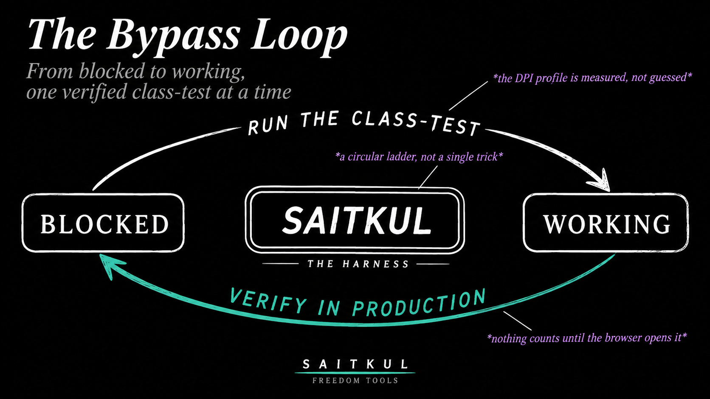

  

### Principles

- **The DPI profile is measured, not guessed** — class-test first, always.
- **A circular ladder, not a single trick** — strategies built from verified lines only.
- **Nothing counts until the browser opens it** — production is the only judge.

  

